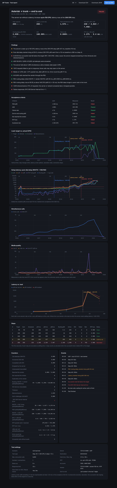
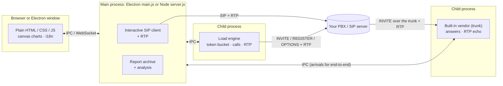

<div align="center">


# SIP Tester

**Find out how many calls your PBX or SIP server really handles — and what breaks first.**

A SIP call generator, registration storm and OPTIONS load tester with light RTP — plus a built-in carrier trunk on the other side.<br>
It plays **both ends** of your PBX, finds the point where it starts to struggle and writes the performance report for you.

[](https://github.com/peritotr/sip-tester/actions/workflows/ci.yml)
[](LICENSE)


[Türkçe](README.tr.md) · [Server setup guide](docs/server-setup.md) · [Changelog](CHANGELOG.md) · [The story behind it (Medium)](https://medium.com/@leventkaramanli/how-many-calls-can-your-pbx-really-handle-d1de3c77a933)

</div>


## Why

Every PBX, SBC and SIP proxy eventually meets the same questions, usually on a busy Monday morning:

- How many **calls per second** can it set up, and how many **simultaneous calls** can it carry?
- At what load does **post-dial delay** start to climb?
- What happens when 2,000 phones **re-register at once** after an outage?
- Does audio still flow cleanly when the box is busy, or do packets start to drop?

- How long does the PBX take to **route a call out to the trunk**, and does every call get there — exactly once?

SIP Tester answers them with real SIP traffic: complete call flows with digest authentication (INVITE → 100 → 180 → 200 → ACK → hold → BYE), registrations, OPTIONS, and G.711 media on a sample of the calls. A **step test** climbs the rate until the server bends, and the report says, in plain language, *"the server is clean up to 250 CPS; post-dial delay rose at the 300 CPS step (p95 4 → 75 ms); RTP loss 0.64%"* — with the charts to back it up.

The article *[How many calls can your PBX really handle?](https://medium.com/@leventkaramanli/how-many-calls-can-your-pbx-really-handle-d1de3c77a933)* walks through a real run against Asterisk 20 and how the end-to-end measurement works.

It can sit on **both sides** of your PBX: phones (extensions) calling in, and a carrier trunk receiving the calls the PBX routes out. Each call carries a number the trunk side reads back, so the tool measures what neither side can see alone: **routing delay through the PBX, calls that never reach the trunk, and duplicates**.

```
SIP Tester (extensions) ──INVITE──▶  YOUR PBX  ──INVITE──▶  SIP Tester (vendor trunk)
                        ◀────────────── RTP echo ──────────────────────────┘
```

### Highlights

- **Three scenarios**: calls (INVITE), registrations (REGISTER) and OPTIONS
- **2,000+ CPS / 6,000 concurrent calls** from a 2-vCPU machine (signalling)
- **Light RTP**: 20 ms G.711 on up to N calls; packet loss, jitter, silent calls, and **echo round trip** on an echo extension
- **Step tests** that find the knee point automatically
- **Built-in vendor trunk** with optional digest auth that answers, echoes RTP and can behave like a slow or full carrier (delays, CPS limit, channel limit, busy/failure %, early hang-up)
- **End-to-end tracking** through the PBX: routing delay, calls not reached, duplicates
- **Account rotation** (`1000-1499`, password template `pw{user}`) to spread calls over many extensions or simulate a registration storm
- Counts what matters in SIP: **ASR, PDD, 100 Trying time, 503s, timeouts, retransmissions, calls dropped by the server, failed BYEs**
- **Pass / fail against your SLA**, saved reports, PDF / CSV / JSON export
- **Desktop or server**: the same UI as a native app or behind a password in your browser
- A single-call mode with a **full SIP message log** per call for debugging
- **No framework, no database, no build step for the UI**; one runtime dependency (`ws`)

## Features

**Single test**
- Server settings: host, port, UDP/TCP, domain, username, password, auth username, display name, contact IP (NAT), local SIP port, RTP start port, T1 and transaction timeout; saved profiles with encrypted passwords
- OPTIONS ping with response time; REGISTER / unregister with automatic refresh
- Test calls one at a time or in a batch (count + CPS), with or without RTP, PCMU or PCMA
- Calls table: 100 Trying time, PDD, answer time, duration, how the call ended, RTP sent/received, loss, jitter, echo round trip
- Click a call to see its SIP ladder; every message can be expanded and exported

**Load test**
- **Calls**: target CPS, max concurrent calls, hold time range, max ring time (then CANCEL), destination with random digits (`9XXXXXX`) or a list, RTP on up to N calls
- **Registrations**: accounts list or ranges, password template, expiry, optional nonce reuse
- **OPTIONS**: target RPS, max requests in flight
- Constant (duration or count) or **step** tests, ramp-up, several local sockets or TCP connections, back-off on 503
- Live charts: rate, latency (p50/p95/p99 and 100 Trying), simultaneous calls, media quality; failure code and timing breakdowns

**Built-in vendor (trunk)**
- Listens on UDP and TCP on one port; your PBX adds it as a trunk / outbound route (IP-authenticated, or with a username and password)
- Answers after a configurable ring and answer delay, echoes RTP (or stays silent), optionally hangs up after N seconds
- Misbehaves on purpose: CPS limit (503), channel limit (503, cause 34), processing capacity (a queue that slows answers), busy %, failure % with a chosen code
- **End-to-end**: in the load test, the trailing X's of the destination (`8XXXXXXX`) carry a call number; the vendor reads it back and the report shows **routing delay** (client INVITE → vendor INVITE), calls **not reached**, **duplicates**, and whether failures happened inside the PBX or on the trunk side

**Performance reports**
- Saved automatically after every load test; printable to PDF, exportable to CSV/JSON
- Finds the **latency onset** (when and at what rate p95 left its baseline), the **saturation point** and its likely cause (503 overload, timeouts and retransmissions, slow answers, error responses, connection loss, or the test machine itself), peak capacity, latency drift under steady load
- Acceptance criteria (PDD p95/p99, ASR, failure rate, RTP loss, minimum rate) → **PASSED / FAILED**
- Step table, latency-vs-load curve, annotated timelines, event log



**Interface in English and Turkish** (switch in the top-left corner).

## What is measured

| Metric | Definition |
| --- | --- |
| **PDD** (post-dial delay) | INVITE sent → first 180/183 received (or the 200 OK if there was no ringing). The main latency for calls. |
| 100 Trying | INVITE sent → first response. Shows how fast the server's transaction layer reacts. |
| Answer time | INVITE sent → 200 OK. Includes the time the extension rings. |
| **ASR** | Answered calls ÷ call attempts. |
| Dropped | Answered calls the server hung up (BYE) before their hold time ended. |
| Retransmissions | Requests sent again over UDP because no response came within T1, 2·T1, … (RFC 3261 timers). |
| Timeouts | No final response within the response limit (Timer B/F, 32 s by default). |
| RTP loss / jitter | RFC 3550 receive statistics on the media we get back. |
| Echo round trip | Every packet carries its send time; when an echo extension returns it, the round trip is measured. |
| **Routing delay** (end-to-end) | INVITE sent by the client → INVITE received by the built-in vendor: how long the PBX takes to route the call to the trunk. Only with *End-to-end via vendor*. |
| Not reached | Call attempts whose INVITE never arrived at the vendor: rejected or lost inside the PBX. |
| Registrations / OPTIONS latency | Request sent → final response, **including** the 401 challenge round trip. |

Digest challenges (401/407) are answered automatically and counted; they are not failures.

## Getting started

### Desktop app

Download the latest build for your OS from [Releases](https://github.com/peritotr/sip-tester/releases):

| OS | File |
| --- | --- |
| macOS (Apple Silicon / Intel) | `SIP-Tester-x.y.z-mac-arm64.dmg` / `-mac-x64.dmg` |
| Windows | `SIP-Tester-x.y.z-win-x64-setup.exe` (installer) or `-win-x64-portable.exe` |
| Linux | `SIP-Tester-x.y.z-linux-x86_64.AppImage` or `-linux-x64.tar.gz` |

The builds are not code-signed. On macOS, the first time you open the app, go to **System Settings → Privacy & Security → Open Anyway** (or run `xattr -dr com.apple.quarantine "/Applications/SIP Tester.app"`). On Windows, click **More info → Run anyway** in SmartScreen.

To run from source instead:

```bash
git clone https://github.com/peritotr/sip-tester.git
cd sip-tester
npm install
npm start
```

### Server (Docker)

For load tests, run it on a Linux server close to the PBX — in the same data centre, but not on the same machine.

```bash
mkdir sip-tester && cd sip-tester
curl -fsSLO https://raw.githubusercontent.com/peritotr/sip-tester/main/docker-compose.yml
curl -fsSL https://raw.githubusercontent.com/peritotr/sip-tester/main/.env.example -o .env
nano .env                    # set UI_PASSWORD
docker compose up -d
```

Open the UI through an SSH tunnel from your computer:

```bash
ssh -L 8080:127.0.0.1:8080 user@your-server
# browse to http://localhost:8080
```

The container uses host networking: SIP and RTP use UDP ports chosen at run time, and Docker's NAT would get in the way. The full walkthrough — sizing, firewall, PBX configuration and a test plan — is in **[docs/server-setup.md](docs/server-setup.md)**.

Without Docker: `npm install --omit=dev && UI_PASSWORD=... node server.js`.

| Variable | Default | |
| --- | --- | --- |
| `UI_PASSWORD` | — | Required, at least 8 characters |
| `PORT` | `8080` | Web UI port |
| `HOST` | `0.0.0.0` (`127.0.0.1` in `.env.example`) | Address the web UI listens on |
| `DATA_DIR` | `./data` (`/data` in Docker) | Profiles, reports, secret key |

### Trying it without a PBX

`npm run uas` starts a small built-in SIP server on UDP port 5070 that answers calls, echoes RTP and accepts any registration. Point the tool at `127.0.0.1:5070`, call any number.

## Testing your PBX: a quick recipe

1. **Create test extensions** on the PBX, e.g. 1000–1499 with password `pw<extension>` (or one shared password). Allow plenty of calls per extension.
2. **Create a destination that answers by itself.** An echo test is best: it answers immediately and sends your audio back, so media is measured both ways. On Asterisk: `exten => 600,1,Answer()` / `same => n,Echo()`. On FreeSWITCH the stock `9196` echo extension works.
3. **Single test** (left panel): enter the server and one extension, press **Connect**, then **OPTIONS** and **Register**. Call `600` for 10 s and check the SIP log and RTP columns.
4. **Load test → Calls → Step**: accounts `1000-1499`, password template `pw{user}`, destination `600`, start 10 CPS, increment 10, target 200, step 60 s, hold 20–40 s, RTP on 100 calls. Open the report when it finishes.

### End to end through the PBX

1. **Start the vendor** (left panel, bottom): port e.g. `5080`; *Network (0.0.0.0)* if the PBX is on another machine. Optionally set a trunk username and password.
2. **On the PBX, add a trunk** to that address and an outbound route that sends a test prefix to it, e.g. `8XXXXXXX`. Asterisk (PJSIP):

   ```ini
   ; pjsip.conf
   [vendor-auth]
   type=auth
   auth_type=userpass
   username=perito
   password=trunkpw

   [vendor]
   type=aor
   contact=sip:TESTER-IP:5080

   [vendor]
   type=endpoint
   context=from-internal
   allow=ulaw,alaw
   direct_media=no
   outbound_auth=vendor-auth
   aors=vendor

   ; extensions.conf
   exten => _8XXXXXXX,1,Dial(PJSIP/${EXTEN}@vendor,60)
   ```
3. **Load test → Calls**: destination `8XXXXXXX` (at least 4 trailing X; the PBX must pass the dialled number to the trunk with its last digits unchanged), tick **End-to-end via vendor**, step test as above.
4. The report adds routing delay, reached / not reached / duplicates and a routing-delay onset. A full trunk (set a channel limit on the vendor) shows up as *"every call reached the vendor, so the failures happened on the trunk side"*.

**Sizing the concurrency limit.** Simultaneous calls ≈ CPS × (ring time + hold time). 100 CPS with 30 s calls means ~3,000 simultaneous calls; set *Max concurrent calls* above that or the target rate can't be reached (the tool warns you before starting).

**Registration storm.** Scenario *Registrations*, accounts `1000-1499`, rate 200 RPS for 30 s. Leave *Reuse nonce* off to make every REGISTER take the full challenge round trip — the worst case after an outage.

## How the analysis works

- **Baseline** — median p95 of the first, lightly loaded seconds (the first step in a step test).
- **Latency onset** — p95 above `max(2 × baseline, baseline + 20 ms)` (or the acceptance limit, if lower) for 3 consecutive seconds.
- **Saturation** — the successful rate (answered calls / 2xx responses) below 90% of a flat target for 3 consecutive seconds, shifted by the typical answer delay. The cause is inferred from that window: 503 responses → overload; fewer TCP connections → connection loss; timeouts or retransmissions → the server isn't answering in time; concurrency limit full → slow answers; other error responses → errors; otherwise the test machine itself.
- **Step status** — *saturated* when the step's median successful rate is below 95% of its target; *latency up* when its p95 is above the onset threshold.
- **Peak capacity** — best 10-second average of the successful rate.

## Under the hood



**One codebase, two shells.** The SIP stack, load engine and analysis are plain Node.js modules. The desktop app wraps them in Electron (`main.js` + `preload.js`); the server edition wraps the same modules in a small HTTP + WebSocket server (`server.js`). The UI doesn't know which one it is talking to.

**A small SIP stack written for load.** `sip-core.js` (~600 lines) parses and builds messages, handles digest authentication (MD5, SHA-256, `qop=auth`, nonce reuse), runs client transactions with RFC 3261 retransmission timers over UDP or TCP, answers in-dialog requests (BYE, re-INVITE, OPTIONS) and takes care of CANCEL and ACK rules. It has been run against Asterisk 20 (PJSIP) and its own test UAS.

**End to end on one clock.** The vendor runs in its own process on the same machine. Arrival times use `performance.timeOrigin + performance.now()`, the same clock in both processes; arrivals are batched every 100 ms through the main process to the load engine, which matches them to the calls it sent by the number in the last digits.

**Measurement stays honest.** The load engine runs in its own process (Electron `utilityProcess` on desktop, `child_process.fork` on the server), so the UI can never slow it down. A token bucket ticks every 2 ms; latencies go into logarithmic histograms (~3% buckets), so p50/p95/p99 cost O(1) memory however long the test runs. RTP sockets are bound before the test starts and rest 2 s between calls so late packets can't pollute the next call's statistics.

### Tech stack

| Layer | Built with |
| --- | --- |
| SIP / RTP | Hand-written in Node.js (`dgram`, `net`): parser, digest auth, transactions, dialogs, G.711 RTP with RFC 3550 statistics |
| Runtime | Node.js 18+ (22 in Docker), worker processes over IPC |
| Desktop | Electron 33, `electron-builder` for DMG / NSIS / portable / AppImage, passwords in the OS keychain (`safeStorage`) |
| Server | Node `http` + [`ws`](https://github.com/websockets/ws), signed session cookies, AES-256-GCM for stored secrets, login rate limiting |
| UI | Vanilla HTML/CSS/JS, hand-drawn `<canvas>` charts, light/dark theme, English and Turkish |
| Quality | `node:test` suite (SIP core, load engine, analysis, translations) against a built-in test UAS; GitHub Actions for CI and releases |

## Project layout

| Path | |
| --- | --- |
| `sip-core.js` | SIP parsing/building, digest auth, SDP, user agent with transactions, calls, registration |
| `rtp.js` | RTP sessions and socket pool, loss / jitter / echo round trip |
| `sip-client.js` | Interactive client for the single-test view |
| `load-engine.js`, `load-worker.js` | Load engine (own process): scenarios, rate control, concurrency, histograms |
| `mock-vendor.js`, `mock-worker.js` | Built-in vendor (trunk), in its own process in the apps |
| `uas.js` | The vendor as a stand-alone test SIP server (`npm run uas`, tests, benchmark) |
| `reports.js`, `ui/analysis.js` | Report archive and performance analysis |
| `main.js`, `preload.js` | Desktop app (Electron) |
| `server.js`, `ui/web-api.js` | Web server edition (HTTP + WebSocket, password login) |
| `ui/` | User interface; `ui/i18n.js` for translations |
| `test/`, `tools/` | Test suite; `bench.js` (CLI benchmark), `i18n-keys.js` |

## Development

```bash
npm install
npm start          # desktop app
npm run server     # web edition (set UI_PASSWORD first)
npm test           # SIP core, load engine, vendor / end-to-end, analysis and translation tests
npm run bench      # 1,000 CPS for 30 s against the built-in UAS
npm run uas        # built-in test SIP server on udp/5070
npm run dist       # build installers for the current OS into dist/
```

## Limits (v0.x)

- UDP and TCP; TLS (SIPS) and SRTP are not supported yet.
- End-to-end measurement needs the dialled number to reach the trunk with its last digits unchanged.
- The vendor only receives calls; the tool does not yet place calls *from* the trunk side towards extensions (inbound DID load).
- Media is G.711 only (PCMU/PCMA), silence payload with a timing marker; no audio files, no MOS estimate.
- No DNS SRV/NAPTR: the host is resolved with a plain A lookup and every request goes to it.

## Security

The tool can generate thousands of calls per second against the server it points at. Keep the web UI behind an SSH tunnel or an HTTPS reverse proxy with a strong `UI_PASSWORD`. Saved passwords are encrypted at rest (OS keychain on desktop, AES-256-GCM on the server); passwords and password templates are never written into reports.

Only test systems you own or are authorised to test, and never route test calls to the public telephone network.

## License

[MIT](LICENSE) © Levent Karamanlı
