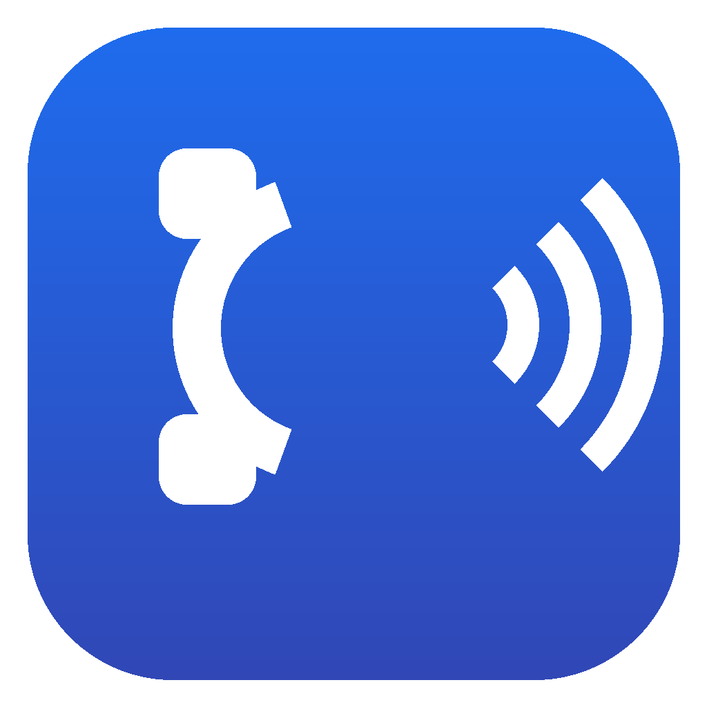
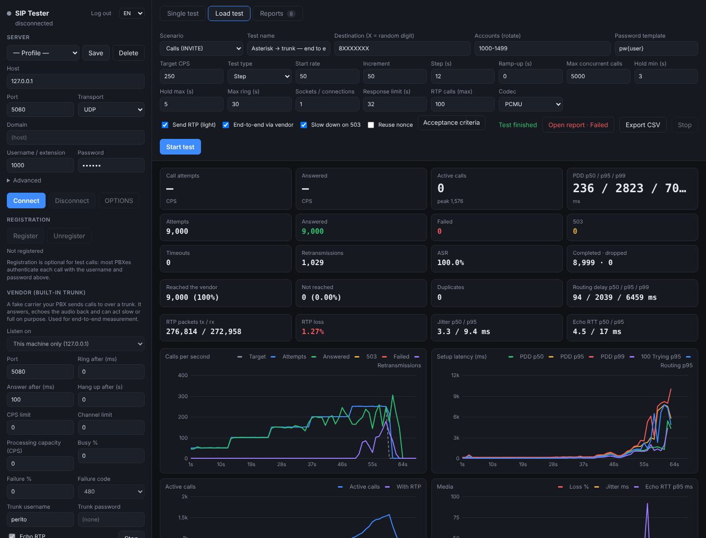

<div align="center">



# SIP Tester

**PBX'inin veya SIP sunucunun gerçekte kaç aramayı kaldırdığını — ve ilk neyin bozulduğunu — öğren.**

Hafif RTP'li SIP arama üreteci, kayıt (REGISTER) fırtınası ve OPTIONS yük testi — karşı tarafta da dahili bir operatör trunk'ı.<br>
PBX'inin **iki ucunda** birden durur, zorlanmaya başladığı noktayı bulur ve performans raporunu senin yerine yazar.

[English](README.md) · [Sunucu kurulum rehberi](docs/server-setup.md) · [Değişiklikler](CHANGELOG.md)

</div>



## Neden

Her PBX, SBC ve SIP proxy er geç aynı sorularla karşılaşır — genelde yoğun bir pazartesi sabahı:

- Saniyede kaç **arama kurabiliyor**, aynı anda kaç **eşzamanlı arama** taşıyabiliyor?
- **Çevir sesi gecikmesi (PDD)** hangi yükte artmaya başlıyor?
- Bir kesintiden sonra 2.000 telefon **aynı anda yeniden kaydolunca** ne oluyor?
- Kutu yoğunken ses hâlâ temiz mi, yoksa paketler düşmeye mi başlıyor?

SIP Tester bunları gerçek SIP trafiğiyle cevaplar: digest kimlik doğrulamalı eksiksiz arama akışları (INVITE → 100 → 180 → 200 → ACK → konuşma → BYE), kayıtlar, OPTIONS ve aramaların bir bölümünde G.711 medya. **Kademeli test** hızı sunucu eğilene kadar artırır; rapor da sade bir dille *"sunucu 250 CPS'e kadar temiz; 300 CPS basamağında PDD yükseldi (p95 4 → 75 ms); RTP kaybı %0,64"* der ve grafiklerle destekler.

PBX'inin **iki tarafında** durabilir: içeri arayan telefonlar (dahililer) ve PBX'in dışarı yönlendirdiği aramaları alan bir operatör trunk'ı. Her arama, trunk tarafının geri okuduğu bir numara taşır; böylece araç iki tarafın tek başına göremediğini ölçer: **PBX içinden yönlendirme gecikmesi, trunk'a hiç ulaşmayan aramalar ve çift gelenler**.

```
SIP Tester (dahililer) ──INVITE──▶  PBX  ──INVITE──▶  SIP Tester (vendor trunk)
```

### Öne çıkanlar

- **Üç senaryo**: aramalar (INVITE), kayıtlar (REGISTER) ve OPTIONS
- 2 vCPU'lu bir makineden **2.000+ CPS / 6.000 eşzamanlı arama** (sinyalleşme)
- **Hafif RTP**: en fazla N aramada 20 ms G.711; paket kaybı, jitter, sessiz aramalar ve echo dahilisinde **gidiş-dönüş süresi**
- Kırılma noktasını otomatik bulan **kademeli testler**
- Opsiyonel digest kimlik doğrulamalı **dahili vendor trunk**: cevaplar, RTP'yi yansıtır, yavaş veya dolu bir operatör gibi davranabilir (gecikme, CPS sınırı, kanal sınırı, meşgul/hata %, erken kapatma)
- PBX içinden **uçtan uca takip**: yönlendirme gecikmesi, ulaşmayan ve çift aramalar
- Aramaları çok sayıda dahiliye yaymak veya kayıt fırtınası oluşturmak için **hesap rotasyonu** (`1000-1499`, şifre şablonu `pw{user}`)
- SIP'te önemli olanı sayar: **ASR, PDD, 100 Trying süresi, 503'ler, zaman aşımları, yeniden gönderimler, sunucunun düşürdüğü aramalar, başarısız BYE'ler**
- SLA'ya göre **GEÇTİ / KALDI**, kaydedilen raporlar, PDF / CSV / JSON dışa aktarma
- **Masaüstü veya sunucu**: aynı arayüz yerel uygulama olarak ya da tarayıcıda şifreyle
- Hata ayıklama için arama başına **tam SIP mesaj logu** olan tekil test modu
- **Framework yok, veritabanı yok, arayüz için derleme adımı yok**; tek çalışma zamanı bağımlılığı (`ws`)

## Neler ölçülür

| Metrik | Tanım |
| --- | --- |
| **PDD** (çevir sesi gecikmesi) | INVITE gönderimi → ilk 180/183 (çalma yoksa 200 OK). Aramalar için ana gecikme metriği. |
| 100 Trying | INVITE → ilk yanıt. Sunucunun işlem katmanının ne kadar hızlı tepki verdiğini gösterir. |
| Cevap süresi | INVITE → 200 OK. Dahilinin çalma süresini de içerir. |
| **ASR** | Cevaplanan arama ÷ arama denemesi. |
| Düşen | Konuşma süresi bitmeden sunucunun kapattığı (BYE) cevaplanmış aramalar. |
| Yeniden gönderim | UDP'de T1, 2·T1, … içinde yanıt gelmediği için tekrar gönderilen istekler (RFC 3261 zamanlayıcıları). |
| Zaman aşımı | Yanıt limiti içinde nihai yanıt yok (Timer B/F, varsayılan 32 sn). |
| RTP kaybı / jitter | Geri gelen medyada RFC 3550 alma istatistikleri. |
| Echo gidiş-dönüş | Her paket gönderim zamanını taşır; echo dahilisi geri gönderince gidiş-dönüş ölçülür. |
| **Yönlendirme gecikmesi** (uçtan uca) | Client'ın gönderdiği INVITE → dahili vendor'a gelen INVITE: PBX'in aramayı trunk'a yönlendirme süresi. Yalnızca *Vendor üzerinden uçtan uca* açıkken. |
| Ulaşmayan | INVITE'ı vendor'a hiç gelmeyen aramalar: PBX içinde reddedilen veya kaybolanlar. |
| Kayıt / OPTIONS gecikmesi | İstek → nihai yanıt, 401 sorgu turu **dahil**. |

Digest sorguları (401/407) otomatik cevaplanır ve sayılır; hata sayılmaz.

## Başlarken

### Masaüstü uygulaması

İşletim sistemine uygun son sürümü [Releases](https://github.com/peritotr/sip-tester/releases) sayfasından indir (macOS `.dmg`, Windows kurulum veya taşınabilir `.exe`, Linux `.AppImage`). Sürümler imzasız: macOS'ta ilk açılışta **Sistem Ayarları → Gizlilik ve Güvenlik → Yine de Aç**, Windows'ta SmartScreen'de **Ek bilgi → Yine de çalıştır**.

Kaynaktan çalıştırmak için:

```bash
git clone https://github.com/peritotr/sip-tester.git
cd sip-tester
npm install
npm start
```

### Sunucu (Docker)

Yük testleri için PBX'e yakın — aynı veri merkezinde ama aynı makinede olmayan — bir Linux sunucuda çalıştır.

```bash
mkdir sip-tester && cd sip-tester
curl -fsSLO https://raw.githubusercontent.com/peritotr/sip-tester/main/docker-compose.yml
curl -fsSL https://raw.githubusercontent.com/peritotr/sip-tester/main/.env.example -o .env
nano .env                    # UI_PASSWORD'ü ayarla
docker compose up -d
ssh -L 8080:127.0.0.1:8080 kullanici@sunucun   # bilgisayarından; sonra http://localhost:8080
```

Konteyner host ağını kullanır: SIP ve RTP çalışma anında seçilen UDP portlarını kullanır, Docker'ın NAT katmanı araya girmemeli. Boyutlandırma, firewall, PBX ayarları ve test planı için **[docs/server-setup.md](docs/server-setup.md)**.

### PBX olmadan denemek

`npm run uas`, UDP 5070'te aramaları cevaplayan, RTP'yi geri yansıtan ve her kaydı kabul eden küçük bir SIP sunucusu başlatır. Aracı `127.0.0.1:5070`'e yönlendir, herhangi bir numarayı ara.

## PBX'ini test etmek: kısa tarif

1. PBX'te **test dahilileri** aç, ör. 1000–1499, şifre `pw<dahili>` (veya ortak bir şifre). Dahili başına arama sınırını yüksek tut.
2. **Kendi kendine cevaplayan bir hedef** oluştur. En iyisi echo test: hemen cevaplar ve sesini geri gönderir, medya iki yönde ölçülür. Asterisk'te: `exten => 600,1,Answer()` / `same => n,Echo()`. FreeSWITCH'te hazır `9196` echo dahilisi işe yarar.
3. **Tekil test** (sol panel): sunucuyu ve bir dahiliyi gir, **Bağlan**, sonra **OPTIONS** ve **Kaydol**. `600`'ü 10 sn ara; SIP logunu ve RTP sütunlarını kontrol et.
4. **Yük testi → Aramalar → Kademeli**: hesaplar `1000-1499`, şifre şablonu `pw{user}`, aranan `600`, başlangıç 10 CPS, artış 10, hedef 200, basamak 60 sn, konuşma 20–40 sn, 100 aramada RTP. Bitince raporu aç.

### PBX içinden uçtan uca

1. **Vendor'ı başlat** (sol panel, alt): port ör. `5080`; PBX başka makinedeyse *Ağdan erişilebilir (0.0.0.0)*. İstersen trunk kullanıcı adı ve şifresi ver.
2. **PBX'te bu adrese bir trunk** ve test ön ekini (ör. `8XXXXXXX`) ona gönderen bir dış hat kuralı tanımla. Asterisk örneği İngilizce README'de.
3. **Yük testi → Aramalar**: aranan `8XXXXXXX` (sonda en az 4 X; PBX numaranın son hanelerini trunk'a değiştirmeden geçirmeli), **Vendor üzerinden uçtan uca** kutusunu işaretle.
4. Rapor yönlendirme gecikmesini, ulaşan / ulaşmayan / çift aramaları ve yönlendirme gecikmesinin başladığı yükü ekler. Dolu bir trunk (vendor'da kanal sınırı) *"tüm aramalar vendor'a ulaştı; hatalar trunk tarafında oldu"* olarak görünür.

**Eşzamanlılık sınırı.** Eşzamanlı arama ≈ CPS × (çalma + konuşma süresi). 100 CPS ve 30 sn'lik aramalar ~3.000 eşzamanlı arama demektir; *Maks. eşzamanlı arama* bunun üstünde olmalı, yoksa hedef hıza ulaşılamaz (araç başlatmadan önce uyarır).

**Kayıt fırtınası.** Senaryo *Kayıtlar*, hesaplar `1000-1499`, 30 sn boyunca 200 RPS. *Nonce'u yeniden kullan* kapalıyken her REGISTER sorgu turunun tamamını yaşar — kesinti sonrası en kötü durum.

## Analiz nasıl çalışır

- **Taban** — testin ilk, düşük yüklü saniyelerinin medyan p95'i (kademeli testte ilk basamak).
- **Gecikme başlangıcı** — p95'in 3 saniye üst üste `max(2 × taban, taban + 20 ms)` (veya daha düşükse kabul sınırı) üstünde kalması.
- **Doyma** — başarılı hızın (cevaplanan arama / 2xx yanıt) sabit hedefin %90'ının altında 3 saniye kalması (tipik cevap gecikmesi kadar kaydırılarak). Neden o pencereden çıkarılır: 503 → aşırı yük; azalan TCP bağlantısı → bağlantı kaybı; zaman aşımı veya yeniden gönderim → sunucu zamanında yanıt vermiyor; eşzamanlılık sınırı dolu → yavaş cevap; diğer hata yanıtları → hata; aksi halde test makinesinin kendisi.
- **Tepe kapasite** — başarılı hızın en iyi 10 saniyelik ortalaması.

## Sınırlar (v0.x)

- UDP ve TCP; TLS (SIPS) ve SRTP henüz yok.
- Uçtan uca ölçüm için aranan numaranın son haneleri trunk'a değişmeden ulaşmalı.
- Vendor yalnızca arama alır; trunk tarafından dahililere doğru arama üretme (gelen DID yükü) henüz yok.
- Medya yalnızca G.711 (PCMU/PCMA), zaman işaretli sessizlik; ses dosyası ve MOS tahmini yok.
- DNS SRV/NAPTR yok: host düz A kaydıyla çözülür ve tüm istekler oraya gider.

## Güvenlik

Araç, yöneltildiği sunucuya saniyede binlerce arama üretebilir. Web arayüzünü SSH tüneli veya HTTPS reverse proxy arkasında, güçlü bir `UI_PASSWORD` ile tut. Kaydedilen şifreler şifrelenir (masaüstünde işletim sistemi anahtarlığı, sunucuda AES-256-GCM); şifreler ve şifre şablonları raporlara yazılmaz.

Yalnızca sahibi olduğun veya test yetkin olan sistemleri test et; test aramalarını asla genel telefon şebekesine yönlendirme.

## Lisans

[MIT](LICENSE) © Levent Karamanlı
